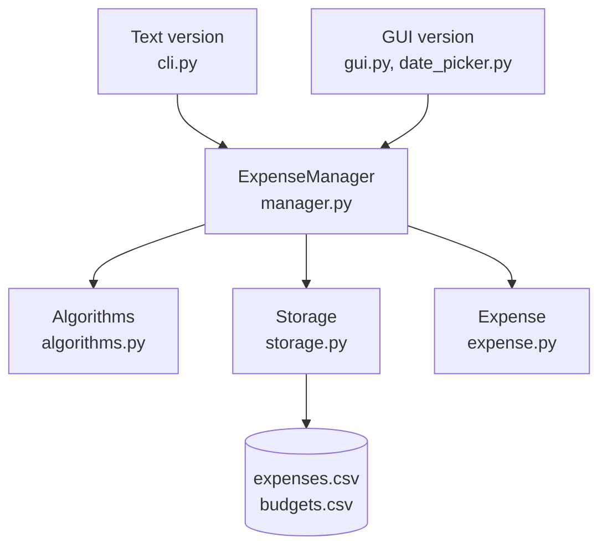
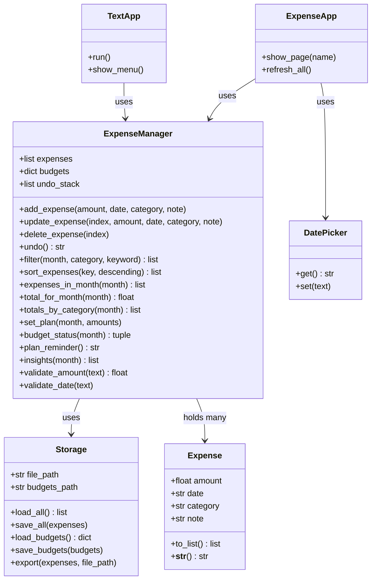

# Expense Tracker – Design

This document explains how the Expense Tracker is built and why.
Requirement IDs (FR-01, NFR-04 …) refer to `requirements.md`.

## 1. Architecture

The program is split into **layers**. A **shared core** does all the work: it checks input, does the calculations and saves the data. Two **front ends** sit on top of it: a text version and a GUI version. They only ask the user for input and show results.



**Why this design**

- **Same features in both versions (FR-24, FR-25):** both front ends call the same `ExpenseManager` methods, so a feature written once works in both.
- **Testable (NFR-06):** the core has no `input()`, `print()` or Tkinter code (NFR-04), so it can be unit-tested without a keyboard or a window.
- **Easy to change:** the GUI can be redesigned, or the CSV files replaced by a database, without touching the rest.
- **Each layer only talks to the one below it.** The front ends never read or write files directly.

## 2. Files and what each one does

```
expense-tracker-project/
├── README.md            How to run the program and the tests
├── requirements.md      Numbered, testable requirements
├── design.md            This document
├── .gitignore           Files Git should not track (data, cache)
├── expense.py           Expense class: one expense
├── storage.py           Storage class: reads and writes the CSV files
├── algorithms.py        merge_sort() and binary search functions
├── manager.py           ExpenseManager class: all rules and calculations
├── cli.py               Text version (menu)          → python cli.py
├── gui.py               GUI version (Tkinter)
├── date_picker.py       Drop-down calendar for the GUI
├── main.py              Starts the GUI version       → python main.py
├── test_algorithms.py   Unit tests for sorting and searching
└── test_manager.py      Unit tests for the manager and storage
```

## 3. Classes



| Class | File | Responsibility |
|---|---|---|
| `Expense` | `expense.py` | Holds the details of one expense |
| `Storage` | `storage.py` | Reads and writes `expenses.csv` and `budgets.csv`; nothing else |
| `ExpenseManager` | `manager.py` | All the rules: validation, add/edit/delete, undo, filters, totals, budgets, insights |
| `TextApp` | `cli.py` | Shows the text menu, asks for input, prints results |
| `ExpenseApp` | `gui.py` | The Tkinter window: sidebar, pages, forms, tables and charts |
| `DatePicker` | `date_picker.py` | A date box with a drop-down calendar (GUI only) |

## 4. Data structures

| Data structure | Used for | Why it suits the problem |
|---|---|---|
| **List** of `Expense` objects | All expenses (`manager.expenses`) | Keeps expenses in order, can grow and shrink, and each expense has a position (index) used to edit or delete it. Easy to sort and loop through. |
| **Dictionary of dictionaries** | Budget plans (`manager.budgets`), e.g. `{"12/2026": {"Rent": 440.0, "Food": 150.0}}` | Finding a month's plan, then a category's amount, is instant (no searching). Months and categories are natural keys. |
| **Stack** (a list used last-in, first-out) | Undo (`manager.undo_stack`) (FR-23) | Undo must reverse the **most recent** change first. A stack does exactly that: `append()` to push, `pop()` to take the last one off. |
| **Dictionary** | Totals per category (`totals_by_category`) | Adding up amounts by category name in one pass through the list. |

**How undo works:** every change pushes a record onto the stack, and undo pops the most recent record and reverses it.

| Change made | Record pushed | What undo does |
|---|---|---|
| Add | `("add", index, None)` | Removes the expense at `index` |
| Delete | `("delete", index, old_expense)` | Puts `old_expense` back at `index` |
| Edit | `("edit", index, old_expense)` | Replaces the expense at `index` with `old_expense` |

## 5. Algorithms

### 5.1 Merge sort (FR-12)

Sorts expenses by date or by amount, in ascending or descending order. It is written by hand instead of using Python's `sorted()`, to show how sorting works.

**Steps**

1. If the list has 0 or 1 items, it is already sorted: return it.
2. Split the list into two halves.
3. Sort each half by calling merge sort on it (recursion).
4. Merge the two sorted halves: compare the first item of each half, take the smaller one, and repeat until both halves are empty.

**Pseudocode**

```
merge_sort(items, key):
    if length of items <= 1:
        return items
    middle = length of items // 2
    left  = merge_sort(items[0 : middle], key)
    right = merge_sort(items[middle : end], key)
    return merge(left, right, key)

merge(left, right, key):
    result = empty list
    while left and right both have items:
        if key(first of left) <= key(first of right):
            move first of left to result
        else:
            move first of right to result
    add whatever is left in left and right to result
    return result
```

**Why merge sort**

- Fast: O(n log n). Bubble sort or selection sort would be O(n²), which is much slower for large lists (NFR-03).
- Stable: expenses with the same date keep their original order.
- Its speed does not depend on how the list starts (already sorted, reversed or random).
- **Key function:** the same code sorts by date or by amount. For dates, the key turns `"10/11/2026"` into `(2026, 11, 10)`, so dates compare in the right order.
- **Descending order:** sort ascending, then reverse the result.

### 5.2 Binary search (FR-13)

Finds the expenses for one month in a list already sorted by date.

**Steps**

1. Turn the first day of the month into a key, e.g. 11/2026 → `(2026, 11, 1)`.
2. Look at the middle expense of the search range.
3. If its date is earlier than the key, search the right half; otherwise search the left half.
4. Repeat until the range is empty. The result is the position of the **first** expense in that month.
5. From that position, collect expenses while they are still in the same month.

**Pseudocode**

```
first_index_on_or_after(sorted_items, target_key):
    low = 0
    high = length of sorted_items
    while low < high:
        middle = (low + high) // 2
        if date_key(sorted_items[middle]) < target_key:
            low = middle + 1
        else:
            high = middle
    return low
```

**Why binary search**

- Fast: O(log n). For 5,000 expenses it needs about 13 checks instead of up to 5,000.
- It needs a **sorted** list, which is why it works together with merge sort.

### 5.3 Other calculations

| Calculation | Formula | Requirement |
|---|---|---|
| Budget used | spent ÷ planned × 100 → OK (< 80%), WARNING (80–100%), OVER (> 100%) | FR-18 |
| Change from last month | (this month − last month) ÷ last month × 100 | FR-21 |
| Previous month | first day of the month minus one day (handles January → December) | FR-21 |
| Average per day | month total ÷ number of days counted | FR-21 |

## 6. Data files

Both files are CSV, so they open in Excel. Both versions of the program use the same files.

**`expenses.csv`** (FR-08)

| Column | Example | Notes |
|---|---|---|
| amount | `12.5` | Number, stored without the £ sign |
| date | `10/11/2026` | DD/MM/YYYY |
| category | `Food` | One of the six categories |
| note | `Lunch` | Can be empty |

**`budgets.csv`** (FR-15): one row per month and category

| Column | Example |
|---|---|
| month | `12/2026` |
| category | `Rent` |
| amount | `440.0` |

**Rules**

- Every add, edit and delete saves the whole list straight away (FR-08).
- If a file does not exist, the program starts empty (FR-09).
- A broken row is skipped instead of crashing the program (NFR-07).
- Both files are in `.gitignore`, because they hold personal data, not code.

## 7. Validation and errors

All checks happen in `ExpenseManager`, so both versions validate in the same way (NFR-02).

| Input | Rule | Error message |
|---|---|---|
| Amount | A number above 0; `£` allowed | "Amount must be a number, e.g. 12.50" / "Amount must be more than 0." |
| Date | A real date in DD/MM/YYYY | "Date must be in the format DD/MM/YYYY, e.g. 10/11/2026" |
| Category | One of the six categories | "Please choose a category." |
| Budget amounts | Empty, or a number of 0 or more; at least one above 0 | "The amount for Food must be a number." |
| Menu choice (text version) | One of the listed numbers | "Please enter a number from the menu." |

When a rule is broken, the manager **raises** a `ValueError` with the message. The text version catches it, prints the message and asks again. The GUI catches it and shows the message in a pop-up box.

## 8. Text version design (`cli.py`)

The text version runs in a loop until the user chooses Exit.

```
==============================
   EXPENSE TRACKER
==============================
 1. Add an expense
 2. List expenses
 3. Edit an expense
 4. Delete an expense
 5. Search, filter and sort
 6. Budget plan
 7. Monthly report and insights
 8. Export to CSV
 9. Undo last change
 0. Exit
------------------------------
Choose an option:
```

- **Wrong menu choice:** the menu shows "Please enter a number from the menu." and asks again (FR-24).
- **Wrong input** (amount, date, category): the message is shown and the same question is asked again, so the user doesn't have to start over.
- **Listing:** expenses are printed in a numbered, lined-up table. The number is used to choose an expense to edit or delete.

```
 #   Date        Category    Amount   Note
 1   20/11/2026  Transport   £24.00   to Cannock
 2   10/11/2026  Food        £12.50   Lunch
--------------------------------------------
 Total: £36.50
```

## 9. GUI design (`gui.py`)

A window with a menu on the left and one page on the right.

```
+--------------+------------------------------------------------+
| EXPENSE      |  Expenses                                      |
| TRACKER      |  +------------------------------------------+  |
|              |  | Amount | Date [▼] | Category ▼ | Note |Add| |
| > Dashboard  |  +------------------------------------------+  |
|   Expenses   |  Month ▼  Category ▼  Search [      ]  Sort ▼  |
|   Insights   |  +------------------------------------------+  |
|              |  | DATE       CATEGORY   AMOUNT   NOTE      |  |
|              |  | 20/11/2026 Transport  £24.00   Cannock   |  |
|              |  | 10/11/2026 Food       £12.50   Lunch     |  |
|              |  +------------------------------------------+  |
| [+ Add]      |  Total £36.50     [Edit] [Delete] [Undo] [Export] |
+--------------+------------------------------------------------+
```

| Page | What it shows | Requirements |
|---|---|---|
| **Expenses** | Add/edit form with date picker, filters, search, sort, table, edit, delete, undo, export | FR-01 to FR-13, FR-22, FR-23 |
| **Dashboard** | Spent, planned and left-to-spend cards; budget bar; plan button; spent-vs-plan bar chart; pie chart | FR-14 to FR-20, FR-25 |
| **Insights** | Insight sentences; line graph of spending per month against the budget | FR-21, FR-25 |

Charts are drawn on a Tkinter `Canvas`, so no extra libraries are needed (NFR-05).

## 10. Testing approach

- **Automated tests** (`unittest`) for the shared core, written on the same day as each feature:
  - `test_algorithms.py`: merge sort compared with `sorted()` (normal, empty, one item, already sorted, reversed); binary search compared with checking every item.
  - `test_manager.py`: validation, add/edit/delete, saving and reloading, filters, totals, budgets, reminders, undo, insights.
- Tests use temporary files, so they never touch real data.
- **Manual tests** for both front ends, recorded in a test table with the requirement ID, input, expected result and actual result.
- Run all automated tests with: `python -m unittest`
